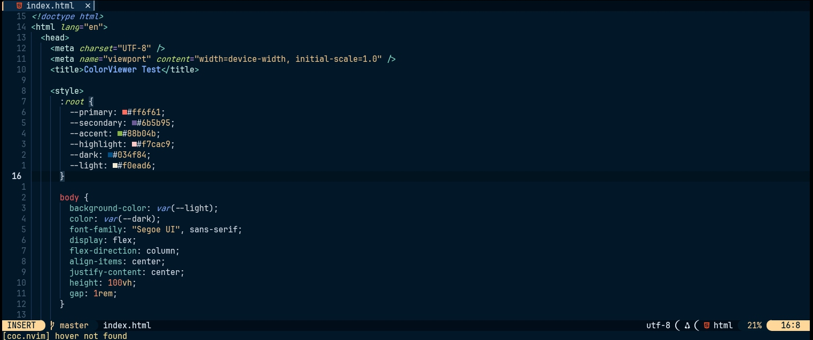

# 🎨 colorviewer.nvim



A Neovim plugin that displays VSCode-like color swatches inline for color names in your code.
No fancy dependencies. No lag. Just beautiful simplicity 😋

## Features

- Shows a colored box before recognized color names (e.g., `red`, `green`, `#ff0000`) in supported filetypes.
- Automatically works in CSS, HTML, JS, JSX, TSX, Vue, and more.

## Installation
use your favourite plugin manager

**Using [lazy.nvim](https://github.com/folke/lazy.nvim):**
```lua
{
  'Godswill-255/colorviewer.nvim',
  config = function()
    require('colorviewer').setup({
      symbol = "■",
    })
  end
}
```
**Using [Packer.nvim](https://github.com/wbthomason/packer.nvim):**
```lualua
use {'Godswill-255/colorviewer.nvim',
  config = function()
    require('colorviewer').setup({
      symbol = "■",
    })
  end
}
```

**Using [init.vim](https://neovim.io/doc/user/plugin.html):**
```vim
Plug 'Godswill-255/colorviewer.nvim'
lua << EOF
require('colorviewer').setup({
  symbol = "■",
})
EOF
```


## 📜 License

Released under the [MIT License](./LICENSE).  
© 2025 Rehd — free to use, modify, and share.
(｡•̀ᴗ-)✧
